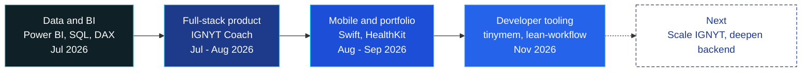

**Data analyst and full-stack developer.** I build analytics that people act on and the software systems behind them: SQL models, Power BI dashboards, and production web and mobile applications.

## About

I started in mechanical engineering, working on the brake system of a Formula Student car, before moving into data analytics and then into building complete software products. That background shapes how I work: measure first, understand what the data shows, then build the system that acts on it.

| | |
|---|---|
| **Focus** | Business intelligence, data analytics, full-stack product development |
| **Currently building** | IGNYT Coach (trainer management platform), the IGNYT iOS app, and open-source developer tooling |
| **Core stack** | Python, TypeScript, SQL, FastAPI, Next.js, PostgreSQL, Power BI |
| **Learning** | Azure data engineering |

---

## Open Source

Tools I built for my own workflow and released because the problems are not mine alone. Free, MIT, no account and no server.

| Project | What it does | |
|---|---|---|
| **[tinymem](https://github.com/varun642002/tinymem)** | Persistent memory for Claude Code. It writes down what you taught it about a project and hands that back at the start of the next session. Zero dependencies, plain JSONL on your own disk. |  |
| **[lean-workflow](https://github.com/varun642002/lean-workflow)** | Ten token-lean agents and six workflow skills for Claude Code — plan, build, debug, test, review, secure and ship — each with a hard limit on what it reads and how much it reports. |  |
| **[erp-starter-kit](https://github.com/varun642002/erp-starter-kit)** | A complete multi-branch ERP base: sales, stock, invoices, cash book, service, payroll and WhatsApp. React, TypeScript, Express, PostgreSQL and Firebase. Fork it and build your own. |  |

---

## Featured Projects

### 1. IGNYT Coach

A platform for personal trainers, gyms and nutrition coaches. Owners, trainers and assistants manage clients, build training programmes and meal plans, run check-ins, message clients and bill them. Assigned work syncs directly into the client-facing IGNYT app.

**Why it matters:** independent trainers and small gyms typically run their business across spreadsheets, group chats and separate payment tools. This consolidates programming, billing and communication into one system with role-based access.

[Repository](https://github.com/varun642002/ignyt-coach)

### 2. Ai-Data-Analytics-workspace

An analytics workspace covering data profiling, cleaning, exploratory analysis, SQL querying, visualization and dashboards, with AI assisting the interpretation layer.

**Why it matters:** most analysis time goes into profiling and cleaning before any insight appears. This brings that setup work into a single workspace instead of a chain of notebooks and scripts.

[Repository](https://github.com/varun642002/Ai-Data-Analytics-workspace)

### 3. IGNYT — fitness and nutrition app

The client-facing side of IGNYT: a Next.js web app and a native iOS build (Swift, HealthKit integration, Codemagic CI) that receives programmes assigned by a coach in IGNYT Coach.

**Why it matters:** a trainer's plan only works if the client can follow it from their phone, with health data feeding back into the loop.

[Website](https://ignytfit.in) · [Web repository](https://github.com/varun642002/IGNYTfit.in) · [iOS repository](https://github.com/varun642002/Ignyt-ios)

### 4. Olist E-Commerce Sales Analysis

Executive, Sales and Customer Insights dashboards built on the Olist Brazilian e-commerce dataset.

**Why it matters:** covers the full BI workflow — modeling raw transactional data, writing DAX measures, and presenting results for different audiences (executives, sales, customer operations).

[Repository](https://github.com/varun642002/Olist-Ecommerce-Sales-Analysis-powerbi)

### 5. HR Workforce Analytics Dashboard

A Power BI dashboard analyzing employee demographics, workforce distribution, attrition trends and satisfaction.

**Why it matters:** attrition is costly and often invisible until it becomes a problem; this surfaces the trend early enough for HR to act.

[Repository](https://github.com/varun642002/Hr-workforce-analytics-dashboard)

---

## Technical Skills

| | |
|---|---|
| **Languages** | Python, TypeScript, SQL, Swift |
| **Frontend** | React, Next.js, Tailwind CSS |
| **Backend** | FastAPI, Node.js |
| **Databases** | PostgreSQL, SQLite |
| **Data and BI** | Power BI, DAX, Power Query, Excel, Google Looker Studio |
| **Tooling** | Docker, GitHub Actions, Vercel, Codemagic |

---

## How I Work

- **Start from the user's problem.** IGNYT Coach exists because trainers run their business across several disconnected tools; the goal was to fix that, not to practice a framework.
- **Measure before optimizing.** Coming from BI, I look at the data before deciding on a fix.
- **Keep systems loosely coupled.** IGNYT Coach and the IGNYT app are separate repositories connected by a single HTTP contract, so each can change independently.
- **Ship the whole path.** A dashboard, backend, mobile client and the CI that deploys it — a project is finished when the last step works.
- **Automate the repetitive part.** tinymem and lean-workflow both came out of the same frustration: doing the same explaining, checking and reviewing by hand on every project.

---

## Timeline

---

## GitHub Activity

<picture>
  <source media="(prefers-color-scheme: dark)" srcset="https://github-readme-streak-stats.herokuapp.com/?user=varun642002&hide_border=true&background=0D1117&ring=22d3ee&fire=22d3ee&currStreakLabel=22d3ee&currStreakNum=ffffff&sideNums=c9d1d9&sideLabels=c9d1d9&dates=8b949e" />
  
</picture>

<picture>
  <source media="(prefers-color-scheme: dark)" srcset="https://raw.githubusercontent.com/varun642002/varun642002/output/snake-dark.svg" />
  <source media="(prefers-color-scheme: light)" srcset="https://raw.githubusercontent.com/varun642002/varun642002/output/snake.svg" />
  
</picture>

---

## Contact

I am open to data analyst, business intelligence and full-stack engineering opportunities.

- **LinkedIn:** [linkedin.com/in/varun64200](https://www.linkedin.com/in/varun64200/)
- **Portfolio:** [varun642002.github.io/varun-portfolio](https://varun642002.github.io/varun-portfolio/)
- **GitHub:** [github.com/varun642002](https://github.com/varun642002)

